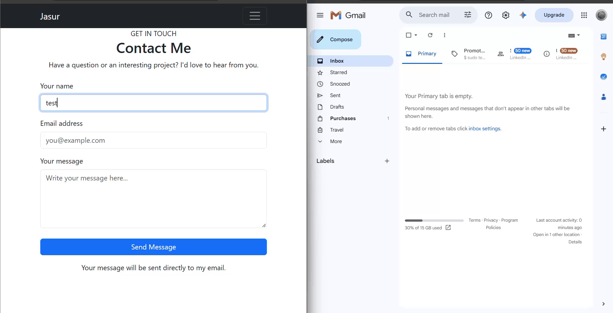

# Flask Email Contact Form

A simple email contact form built with Flask and Python. This feature allows visitors to send messages directly to an email address through a form integrated into a personal website.
## Demo

Here is a demonstration of the email contact form in action:



## Features

- Collects the sender's name, email address, and message.
- Sends messages using Gmail SMTP.
- Uses environment variables to store email credentials.
- Validates required form fields.
- Displays success and error notifications.
- Redirects users after form submission.

## Technologies Used

- Python
- Flask
- HTML5
- Bootstrap 5
- SMTP (`smtplib`)
- `email.message.EmailMessage`
- `python-dotenv`

## How It Works

1. A visitor fills out the contact form on the website.
2. The form submits its data to a Flask endpoint using the HTTP `POST` method.
3. Flask validates the submitted fields and creates an email message.
4. Python connects to Gmail's SMTP server and authenticates the sender.
5. The email is submitted to Gmail for delivery.
6. The website displays a success or error notification.

## Installation

### 1. Clone the repository

```bash
git clone YOUR_REPOSITORY_URL
cd YOUR_PROJECT_DIRECTORY
```

Replace the placeholders with your repository URL and project directory.

### 2. Create and activate a virtual environment

```bash
python -m venv .venv
```

Windows:

```bash
.venv\Scripts\activate
```

Linux or macOS:

```bash
source .venv/bin/activate
```

### 3. Install dependencies

```bash
pip install Flask python-dotenv
```

### 4. Configure environment variables

Create a `.env` file in the project root:

```env
FLASK_SECRET_KEY=your_random_secret_key
SENDER_EMAIL=your_gmail@gmail.com
SENDER_PASSWORD=your_google_app_password
RECEIVER_EMAIL=your_gmail@gmail.com
```

Use a Google App Password for SMTP authentication. Do not use your regular Gmail password.

### 5. Run the application

```bash
python app.py
```

Open the website in your browser and navigate to the contact page to test the form.

## Security

- Keep email credentials and secret keys out of source control.
- Add `.env` and `.venv/` to `.gitignore`.
- Do not enable Flask debug mode in production.
- Consider adding CSRF protection and rate limiting before deploying publicly.

## Integration

This contact form is designed to be integrated into a Flask-based personal website. Its email-sending functionality can also be adapted for other Flask applications.

## Author

Jasur Xayitmurodov

GitHub: [jasurxayitmuradov](https://github.com/jasurxayitmuradov)
